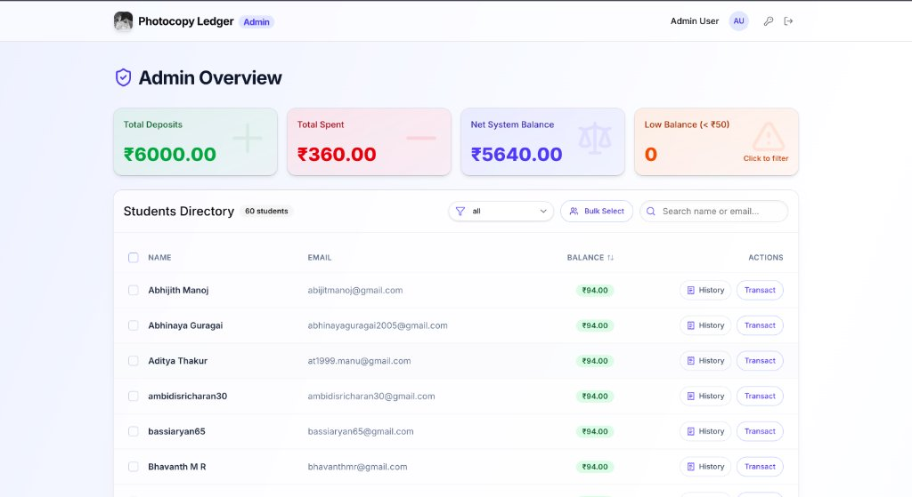
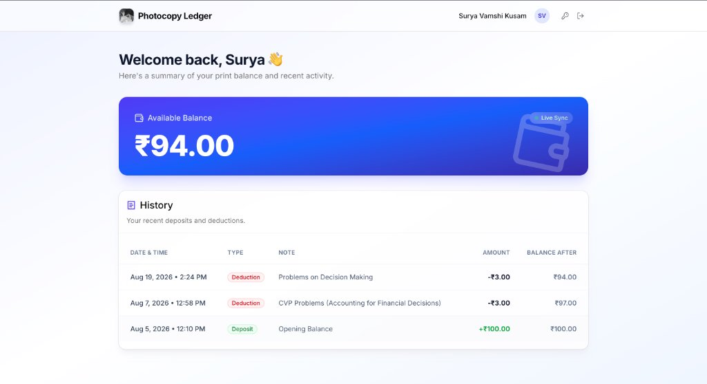
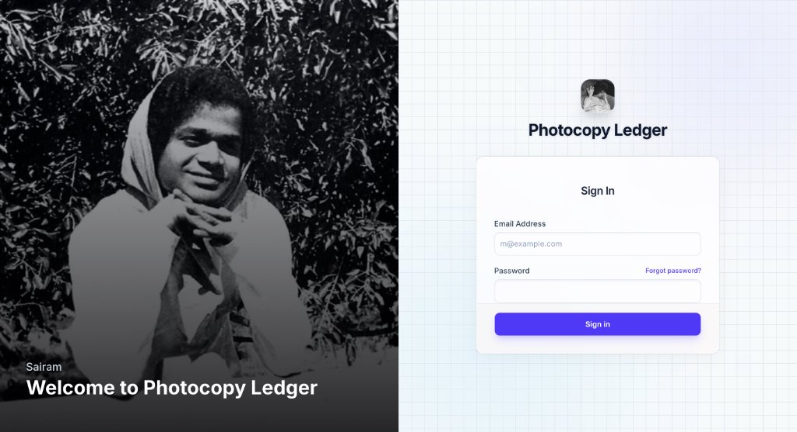
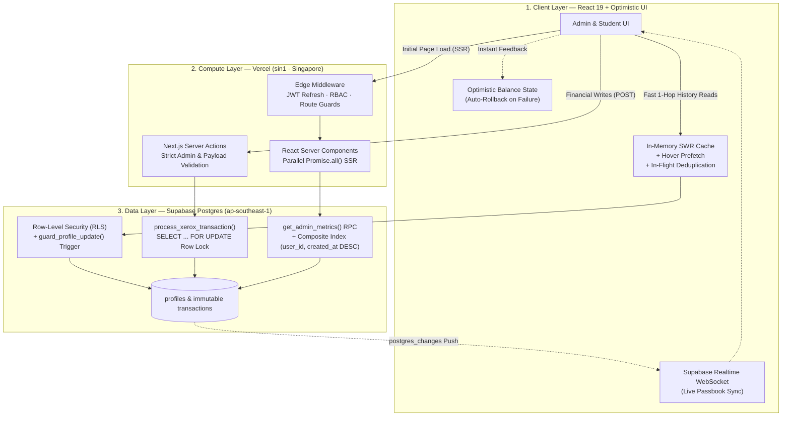

<div align="center">


# Photocopy Ledger

### A Real-Time, Zero-Trust Campus FinTech Ledger Built for Sub-150ms Reads & ACID Integrity

[](https://photocopy-ledger.vercel.app)
[](https://nextjs.org/)
[](https://react.dev/)
[](https://www.typescriptlang.org/)
[](https://supabase.com/)
[](https://tailwindcss.com/)

*Replacing manual campus photocopy registers for 60+ MBA students with an **immutable append-only PostgreSQL ledger**, **co-located CQRS retrieval**, **fuzzy batch billing**, and **live WebSocket passbook sync**.*

[Live App](https://photocopy-ledger.vercel.app) · [Product Showcase](#-product-showcase) · [Architecture](#-system-architecture) · [Retrieval Pipeline](#-data-retrieval--latency-engineering) · [Engineering Decisions](#-engineering-decisions--trade-offs) · [Security Model](#-security--financial-integrity) · [Setup](#-getting-started)

</div>

---

## The Problem & Product Vision

Managing prepaid print accounts for a 60+ student cohort in spreadsheets or paper notebooks creates three real operational failures:
1. **Zero transparency for students** — students only discover low balances after printing.
2. **Slow, error-prone batch billing** — charging 25 students for a shared handout manually takes minutes and invites typos.
3. **No financial auditability** — overwriting a spreadsheet cell erases history and makes disputes impossible to resolve.

**Photocopy Ledger** solves all three using **real FinTech ledger engineering**: append-only accounting, row-locked atomic balance updates, sub-150ms cached reads, and instant live passbook sync.

---

## Product Showcase

### 1. Admin Command Center (`/admin`)
*SQL-aggregated KPI cards, instant search & balance-tier filters, sorting, optimistic single/bulk transactions, and hover-prefetched student history.*

<p align="center">
  
</p>

### 2. Student Real-Time Passbook (`/dashboard`)
*Live balance hero card with WebSocket `Live Sync`, low-balance alerts, IST timestamps, and immutable statement history.*

<p align="center">
  
</p>

### 3. Split-Screen Authentication & Forced Password Gate (`/login`)
*Role-based routing, session cookie preservation on Edge redirects, and mandatory first-login strong-password enforcement.*

<p align="center">
  
</p>

---

## System Architecture

Photocopy Ledger implements a **Co-Located Zero-Trust CQRS Architecture**—separating fast, RLS-secured read paths from strictly validated financial write paths, with Vercel compute pinned directly beside PostgreSQL in **Singapore (`sin1` ↔ `ap-southeast-1`)**.



---

## Data Retrieval & Latency Engineering

A core focus of this project was turning a sluggish multi-hop serverless flow into an **instant, native-feeling retrieval experience**.

### Before vs. After: How Retrieval Works

| Layer | Naive Implementation (Slow) | Engineered Architecture (Fast) | Impact |
| --- | --- | --- | --- |
| **Compute ↔ DB Distance** | Vercel default `iad1` (US East) ↔ Supabase `ap-southeast-1` (Singapore) = ~15,000 km | Co-located via `vercel.json` (`"regions": ["sin1"]`) | Server-to-DB latency dropped from **~300ms → ~2ms** |
| **Student History Modal** | Next.js Server Action `POST /admin` → **4 sequential hops** (Middleware Auth → Middleware Profiles → Action Auth → Transactions) | **Direct 1-hop browser query** secured by Postgres RLS | Eliminated 3 redundant network hops + serverless cold starts |
| **Perceived Latency** | Fetch only starts *after* click; re-fetches on every open | **Hover/Focus Prefetch + In-Flight Deduplication + SWR In-Memory Cache** | **0ms modal open** when hovered or revisited; silent background sync |
| **Initial SSR Page Load** | Sequential `await` waterfall (`users` → `transactions`) | **Parallel `Promise.all()`** fetching on both `/admin` and `/dashboard` | Cuts SSR wait time nearly in half |
| **Global Admin Metrics** | Fetch every transaction row to Node.js (breaks at PostgREST's 1,000-row cap) | **Postgres `get_admin_metrics()` RPC** (with paginated `.range()` fallback) | Constant payload size; scales cleanly past 1,000+ transactions |
| **Database Indexing** | Single-column indexes requiring sort step | **Composite B-Tree Index `(user_id, created_at DESC)`** | Direct sorted index scan per student |
| **Write Responsiveness** | Wait for DB round-trip before updating table | **Optimistic UI** on single & bulk transactions + cache invalidation | Instant visual confirmation with safe rollback on error |

### How the 1-Hop SWR Retrieval Pipeline Works (`AdminClient.tsx`)
1. **Hover Prefetch:** Moving the pointer onto (or focusing) a student's **History** button triggers `prefetchStudentHistory(userId)` silently in the background.
2. **Request Deduplication:** An `inFlightRef` map tracks active promises—if the admin clicks **History** 80ms after hovering, the click attaches to the already running request instead of firing a duplicate query.
3. **Stale-While-Revalidate (SWR):** Cached histories render in **0ms** immediately on modal open, while a lightweight background fetch syncs any new records and updates the UI seamlessly.
4. **Targeted Cache Invalidation:** Posting a single or bulk transaction invalidates only the affected `userId` entries in the cache, keeping every other student's cached history hot.

---

## Engineering Decisions & Trade-Offs

> *Key architectural problems I identified and solved while taking this from prototype to production:*

1. **CQRS-Style Read/Write Split instead of "Server Actions for Everything"**
   - *Trade-off:* Server Actions are ideal for mutations (strict server validation, `revalidatePath`), but using them for interactive read modals adds middleware overhead and serializes requests. Splitting **reads to direct RLS-protected queries** and **writes to Server Actions** gives both maximum speed and strict write security.
2. **Append-Only Ledger with Compensating Corrections instead of Mutable Rows**
   - *Trade-off:* Allowing admins to edit or delete a mistaken entry is simpler to code, but breaks auditability. Following FinTech accounting rules, `transactions` forbids `UPDATE` and `DELETE` at the RLS level; mistakes are fixed via an **Error Correction** workflow that calculates the exact delta (including full `₹0` reversals) and appends a transparent compensating record.
3. **Database-Level Row Locking (`SELECT ... FOR UPDATE`) over Application-Level Balance Math**
   - *Trade-off:* Computing `newBalance = oldBalance - amount` in TypeScript creates a lost-update race condition when two admins transact simultaneously. Moving balance calculation into a `BEFORE INSERT` Postgres trigger with row-level locking makes every balance transition **ACID-atomic**.
4. **Column-Level Trigger Guard to Close RLS Privilege Escalation**
   - *Insight:* A standard RLS policy (`FOR UPDATE USING (auth.uid() = id)`) needed so students can clear `must_change_password` inadvertently lets a student run `update({ role: 'admin', current_balance: 99999 })` from browser DevTools. Adding `guard_profile_update()` blocks non-admins from mutating any protected column at the database boundary.
5. **Deterministic Timezone Formatting (`Asia/Kolkata`) across SSR & Client**
   - *Insight:* Formatting dates with `date-fns` inside a Server Component rendered **UTC** on Vercel while the Client Component rendered **IST**—causing a 5h 30m mismatch on the exact same transaction. Centralizing `Intl.DateTimeFormat` pinned to `Asia/Kolkata` guarantees identical timestamps across server and client.
6. **Fuzzy Batch Selection (`Fuse.js`) for Real-World Campus Workflows**
   - *Insight:* Admins receive raw attendance/print lists copied from WhatsApp or Sheets with partial names or typos. Integrating client-side `Fuse.js` fuzzy matching turns a 10-minute manual clicking chore into a 5-second paste-and-confirm bulk transaction.

---

## Security & Financial Integrity

Defense-in-depth enforced independently across **Edge**, **Application**, and **Database** layers:

- **Zero-Trust RLS Policies:** Students can only `SELECT` their own profile and transactions; only verified admins (`public.is_admin()`) can view all students or insert ledger rows.
- **Immutable Ledger:** No `UPDATE` or `DELETE` policies exist on `public.transactions`.
- **Anti-Tampering Column Guard:** `guard_profile_update()` raises a Postgres exception if a non-admin attempts to change `id`, `role`, `current_balance`, `email`, `full_name`, or `created_at`.
- **Hardened `SECURITY DEFINER` Functions:** All privileged functions pin `SET search_path = public` and use NULL-safe role checks (`v_admin_role IS DISTINCT FROM 'admin'`).
- **Cookie-Safe Session Refresh:** Edge Middleware copies refreshed Supabase session cookies onto every `NextResponse.redirect()`, preventing silent logouts on token rotation.
- **Password Policy & First-Login Gate:** Enforces 8+ chars with uppercase, numeric, and special characters, and blocks dashboard access until `must_change_password` is cleared.

---

## Key Features at a Glance

| Role | Capabilities |
| --- | --- |
| **Admin (`/admin`)** | SQL-aggregated KPI dashboard · Search, balance-tier filter (`< ₹50`, `≤ ₹0`, `≥ ₹50`), & sort · Single & Bulk Deposits / Deductions / Error Corrections · `Fuse.js` Bulk Fuzzy Select · Hover-prefetched History Modal with 1-click **CSV Export** · Optimistic UI updates |
| **Student (`/dashboard`)** | Real-time balance card with **Supabase Realtime (`Live Sync`)** · Live toast notifications on new credits/deductions · Itemized passbook with IST timestamps & running `balance_after` · Low-balance warning banner · Mandatory first-login & inline password change |

---

## Tech Stack

- **Frontend & Compute:** Next.js 16 (App Router, RSC, Server Actions, Edge Middleware), React 19, TypeScript 5
- **Database, Auth & Realtime:** Supabase PostgreSQL, `@supabase/ssr`, Row-Level Security (RLS), PL/pgSQL Triggers & RPCs, Realtime WebSockets
- **UI & Utilities:** Tailwind CSS v4, Base UI / shadcn UI, Lucide Icons, Sonner Toasts, Fuse.js
- **Infrastructure:** Vercel (`sin1` Singapore region co-located with Supabase `ap-southeast-1`)

---

## Project Structure

```text
├── docs/screenshots/                    # README product screenshots
├── public/                              # Branding assets (logo, hero)
├── scripts/                             # Admin CLI utilities (seed students, create admin, cleanup)
├── supabase/
│   ├── schema.sql                       # Complete schema, triggers, RLS, RPC, composite index, Realtime
│   └── migrations/                      # Non-destructive production SQL migrations
├── src/
│   ├── middleware.ts                    # Session cookie refresh, RBAC & password-reset enforcement
│   ├── lib/
│   │   ├── env.ts                       # Validated Supabase environment variable helpers
│   │   ├── format.ts                    # Deterministic IST date formatting & correction helpers
│   │   └── supabase/                    # Browser & SSR Supabase clients
│   ├── components/                      # UI primitives, ChangePasswordDialog, SignOutButton
│   └── app/
│       ├── actions/                     # Validated Server Actions (auth & transactions)
│       ├── login/                       # Split-screen authentication flow
│       ├── change-password/             # Forced first-login password update gate
│       ├── admin/                       # Admin RSC + AdminClient (SWR cache, fuzzy bulk, optimistic UI, CSV)
│       └── dashboard/                   # Student RSC + DashboardLiveClient (Realtime WebSocket sync)
└── vercel.json                          # Pins serverless functions to Singapore (sin1)
```

---

## Getting Started

### 1. Clone & Install
```bash
git clone https://github.com/suryavamshikusam/photocopy-ledger.git
cd photocopy-ledger
npm install
```

### 2. Configure Environment Variables
```bash
cp .env.example .env.local
```
```env
NEXT_PUBLIC_SUPABASE_URL=https://your-project.supabase.co
NEXT_PUBLIC_SUPABASE_ANON_KEY=your-anon-key
SUPABASE_SERVICE_ROLE_KEY=your-service-role-key
```

### 3. Initialize Supabase Database
Run [`supabase/schema.sql`](supabase/schema.sql) in **Supabase Dashboard → SQL Editor** (for existing live databases, run the idempotent migrations in `supabase/migrations/`).

### 4. Seed Accounts *(Optional)* & Run Locally
```bash
npx tsx scripts/create-admin.ts
npx tsx scripts/seed-users.ts
npm run dev
```
Open [http://localhost:3000](http://localhost:3000).

---

<div align="center">
  Engineered for speed, security, and financial accuracy · Deployed on <b>Vercel (sin1)</b> + <b>Supabase</b>
</div>
